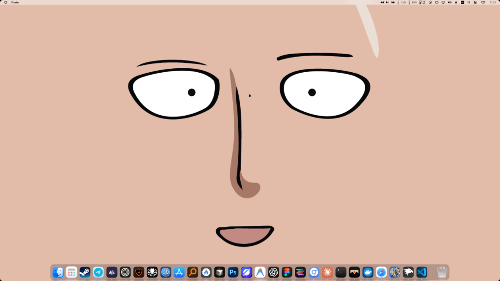
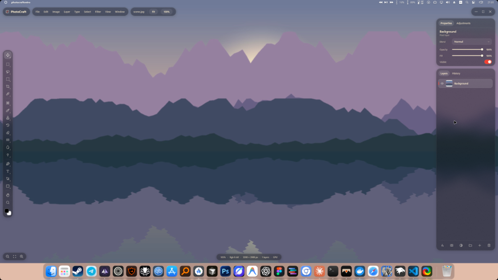

# envwin by Vetro

<p align="center">
  <b>Automated Windows Environment & Customization Deployment Script</b><br>
  <i>Fast, one-click restoration and setup for MyDockFinder, Wallpaper Engine, Material Design Dark Cursors, and Windows Terminal.</i>
</p>

<p align="center">
  
  
  
  
  
</p>

---

## 📸 Preview / Результат

<p align="center">
  
  
</p>

---

## 📖 Overview

**envwin by Vetro** is an all-in-one configuration package and batch deployment utility for Windows. It provides a clean, safe, and automated workflow to migrate and apply custom aesthetic configurations:

- **MyDockFinder**: Complete dock layout, pinned application shortcuts (`ico.ini`), taskbar behaviors, and active macOS themes (`MacOS 26 Pein`).
- **Wallpaper Engine**: Display assignments, profile settings, active playlists (`config.json`), user projects, and animated GIF wallpapers.
- **Cursor Scheme**: System-wide installation and instant live application of the **Material Design Rounded Dark** cursor scheme via native Win32 API calls (no restart or re-login required).
- **Windows Terminal & PowerShell**: Frosted glass Acrylic blur (85% opacity), deep **Tokyo Night** color scheme, padded margins, and a sleek modern PowerShell prompt with Git branch status and intelligent history search.

---

## 📁 Repository Structure

```text
envwin by Vetro/
├── assets/                   # Preview screenshots
│   ├── preview_1.png
│   └── preview_2.png
├── apply_configs.bat         # Russian edition (CP1251 encoded for CMD compatibility)
├── apply_configs_en.bat      # English edition
├── README.md                 # Documentation
├── .gitignore                # Git ignore patterns
└── configs/
    ├── mydockfinder/         # MyDockFinder configuration files & themes
    │   ├── config.ini        # Core program settings (blur, hide taskbar, etc.)
    │   ├── ico.ini           # Pinned shortcuts and dock icon mappings
    │   ├── ico_bak.ini       # Backup icon definitions
    │   ├── keyboard.ini      # Hotkeys & shortcuts
    │   ├── padconfig.xml     # Launchpad setup
    │   └── themes/           # Theme skins and custom application icons
    │       └── MacOS 26 Pein/
    ├── wallpaper_engine/     # Wallpaper Engine configuration & media
    │   ├── config.json       # Monitor layouts, audio levels, active playlists
    │   ├── gifs/             # Animated GIF wallpapers & workshop previews
    │   └── projects/         # Custom user wallpaper projects
    ├── cursor/               # Material Design Rounded Dark cursor package
    │   ├── Install.inf       # Windows Setup INF script
    │   ├── *.cur             # Static cursors (arrow, hand, text, etc.)
    │   └── *.ani             # Animated cursors (working, busy)
    └── terminal/             # Windows Terminal & PowerShell aesthetic setup
        ├── settings.json     # Windows Terminal profile (Tokyo Night, Acrylic 85%, Padding)
        └── Microsoft.PowerShell_profile.ps1 # Sleek minimalist prompt with Git & PSReadLine
```

---

## 🚀 Usage Guide

### 1. Launch the Script
Choose your preferred language:
- **English**: Double-click or run [`apply_configs_en.bat`](apply_configs_en.bat).
- **Russian**: Double-click or run [`apply_configs.bat`](apply_configs.bat).

### 2. Overwrite Warning
Upon launch, a safety notice is displayed reminding you that any conflicting local settings in the target applications will be replaced.

### 3. Interactive Menu
Select which component you want to apply (one action at a time):
```text
  [1] Apply MyDockFinder config         (icons, theme and settings)
  [2] Apply Wallpaper Engine config      (GIFs, playlists and settings)
  [3] Install and apply cursor scheme    (Material Design Rounded Dark)
  [4] Setup Windows Terminal & Prompt    (Tokyo Night, Acrylic Blur, Prompt)
  [0] Exit
```

### 4. Smart Path Detection
The script scans your system automatically:
- Queries 32-bit and 64-bit Steam uninstall registries (AppIDs `1787090` and `431960`);
- Inspects standard Steam libraries on drives `C:`, `D:`, and `E:`;
- Checks running process executables (`dock_64.exe` / `wallpaper64.exe`).

> **Manual Input Fallback**: If the program is installed in a custom directory, you will be prompted to enter the path. Paths can be entered **with or without quotation marks** (e.g., `"C:\My Apps\Dock"` or `C:\My Apps\Dock`).

### 5. Safe Deployment & Instant Reload
- Running processes are safely terminated before file replacement to prevent file locks and avoid configuration loss on program exit.
- Target files and media folders are verified and copied.
- Cursors are registered in `HKCU\Control Panel\Cursors` and applied live through Win32 `SystemParametersInfo(SPI_SETCURSORS)`.
- Terminal settings are placed directly into Windows Terminal's LocalState package and user profile documents.

---

## 🇷🇺 Инструкция на русском языке

### Запуск
- Для работы на русском языке запустите [`apply_configs.bat`](apply_configs.bat).
- Для английского интерфейса запустите [`apply_configs_en.bat`](apply_configs_en.bat).

### Возможности
1. **MyDockFinder**: Полный перенос дока, ярлыков приложений, настроек скрытия панели задач Windows и темы `MacOS 26 Pein`.
2. **Wallpaper Engine**: Восстановление конфига `config.json` (мониторы, профиль, плейлисты) и копирование GIF-обоев.
3. **Курсор**: Установка набора курсоров `Material Design Rounded Dark` в систему с моментальным применением без перезагрузки системы.
4. **Терминал**: Настройка Windows Terminal (цветовая схема Tokyo Night, полупрозрачный акрил с эффектом размытия 85%, отступы, шрифт Cascadia Code) и кастомный минималистичный prompt в PowerShell с отображением Git-веток и навигацией по истории.
5. **Безопасность**: Завершение процессов перед перезаписью, чтобы программы не блокировали файлы и не затирали новые настройки.

---

## 🛠️ Technical Details

- **Operating System**: Windows 10 / Windows 11 (x64)
- **Privileges**: Standard user permissions (elevated administrator rights might be requested by UAC only if writing to restricted system folders).
- **Encoding**: 
  - `apply_configs.bat` is saved in Windows-1251 (ANSI) for full compatibility with native Windows CMD console rendering.
  - `apply_configs_en.bat` is saved in UTF-8 / ASCII.

---

## 👤 Author

Created with ❤️ by **Vetro**.
Part of the **envwin** personal workspace setup.
